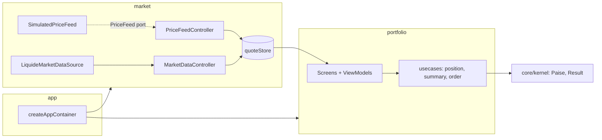

# Live Portfolio

A React Native stock portfolio app that stays correct and smooth while prices tick about twenty
times a second. Real opening prices come from the Liquide OHLC API once per load; movement on top of
them comes from a simulated feed shaped like a socket client.

- **Portfolio** — summary card and holdings, each row live, sortable and filterable, pull to refresh
- **Watchlist** — last price and day change, add from the symbol list, swipe to remove, survives restart
- **Stock detail** — full OHLC, an intraday chart of the ticks since the screen opened, and your position
- **Buy/sell sheet** — validated quantity, live estimate, fills locally at the last price

Built on **React Native 0.88** (New Architecture, Hermes), **React 19.3**, **TypeScript 6** strict,
with Clean Architecture + MVVM and feature-based folders.

The brief asks the README to cover five things:

| Question                                    | Answered in                                                                                 |
| ------------------------------------------- | ------------------------------------------------------------------------------------------- |
| How to install and run                      | [Quick start](#quick-start)                                                                 |
| State and re-render approach, and why       | [State and re-rendering](#state-and-re-rendering), [Library choices](#library-choices)      |
| How Summary handles a holding with no price | [How Summary handles a holding with no price](#how-summary-handles-a-holding-with-no-price) |
| What was skipped, and what comes next       | [What I skipped, and what I would do next](#what-i-skipped-and-what-i-would-do-next)        |
| Roughly how long it took                    | [Time spent](#time-spent)                                                                   |

Architecture reasoning — why Clean Architecture, why MVVM, and where SOLID earned its keep — is in
[Architecture](#architecture).

---

## Quick start

**Prerequisites:** Node ≥ 22.11 (`.nvmrc`), Xcode 16+ with CocoaPods for iOS, Android Studio with
SDK 36 and JDK 17 for Android. See the
[React Native environment setup](https://reactnative.dev/docs/set-up-your-environment).

Install the npm dependencies, then the CocoaPods dependencies from the `ios` directory. Start Metro
and launch the app with the `ios` or `android` package script. If CocoaPods fails on a Unicode
normalization error, the shell locale is not UTF-8.

**Tested on the iOS Simulator (iPhone 17 Pro).** Android builds clean through Gradle, but the
interactive walkthrough — live ticks, trading, both themes — was done on iOS.

The package scripts cover the rest: `verify` runs the whole gate (typecheck, lint, format check and
tests), with `typecheck`, `lint`, `format`, `test` and `bundle:check` available individually.

---

## Architecture

Clean Architecture with MVVM in the presentation layer, organised by feature. Dependencies point
inwards only, and the direction between features is set once in the composition root.

```
src/
├── app/                      Composition root, providers, navigation
│   └── di/createAppContainer.ts   The only file that knows concrete implementations
├── core/                     Framework-level, feature-agnostic
│   ├── kernel/               Result, AppError, Paise (money), Clock — no dependencies
│   ├── config/               Typed build-time config
│   ├── network/              HttpClient port, axios adapter, interceptors, error mapping
│   ├── storage/              KeyValueStorage port, MMKV and in-memory adapters
│   ├── theme/                Tokens, light/dark themes, themed-stylesheet cache
│   ├── navigation/           Route names and params (primitives only)
│   ├── layout/               Breakpoints
│   ├── logging/              Scoped, levelled logger
│   └── di/                   Typed provider/hook pair per feature module
├── features/
│   ├── market/               Prices. No screens of its own.
│   │   ├── domain/           Quote, PriceTick, PriceFeed port, applyTick, calculateDayChange
│   │   ├── data/             Liquide data source, quote mapper, SimulatedPriceFeed
│   │   └── presentation/     Quote/feed/status stores, controllers, PausedBanner, TickChart
│   ├── portfolio/            Holdings, P&L and trading
│   │   ├── domain/           Holding, Order, position/summary/order rules, PlaceOrderUseCase
│   │   ├── data/             Bundled starting holdings, MMKV repository
│   │   └── presentation/     Portfolio, Stock detail and Buy/sell screens
│   └── watchlist/            Followed symbols
│       ├── domain/           Watchlist rules, repository port
│       ├── data/             MMKV repository
│       └── presentation/     Watchlist screen, symbol picker
├── shared/                   Reusable UI, formatting, hooks
└── types/                    Global declarations
```

**Dependency direction.** `market` knows nothing about anyone. `portfolio` depends on `market`
through its public `index.ts`, because a position needs a price. `watchlist` also depends on
`market`, but **not** on `portfolio`: it opens the detail screen by route name, so the two
feature-level siblings never import each other.

The detail screen lives in `portfolio` rather than `market` because it shows both a price and a
position, and `portfolio → market` is the permitted direction.

**Dependency injection** is a composition root plus one typed React context per feature. No
decorators, no reflection, nothing hidden. Features receive capabilities as narrow types rather than
whole modules — `portfolio` gets a `LastPriceReader` (`(symbol) => Paise | null`), not the market
module — which is what keeps the coupling one-way and the fakes trivial in tests.

### Why Clean Architecture

Two risks dominate this brief: money that must never be wrong, and a simulated feed that has to be
replaceable by a real socket. Both come down to keeping the rules away from the frameworks.

Every calculation that can be wrong — position value, P&L, blended averages, order validation, tick
ordering — lives in `domain/` and imports nothing but `core/kernel`. No React, no axios, no MMKV, no
zustand. That is precisely what lets them be plain functions with millisecond unit tests, which the
brief asks for directly.

The layering is enforced by dependency direction rather than by folder names: `domain` declares the
interfaces (`MarketDataRepository`, `HoldingsRepository`, `PriceFeed`, `LastPriceReader`) and `data`
implements them, so nothing inner can reach outward even by accident.

I deliberately skipped the ceremony that usually comes with it. There are no mappers between layers
whose shapes are identical, no repository interface for a thing with one implementation and one
consumer, and no use-case class where a pure function reads better — `calculateSummary` is a
function, not a `CalculateSummaryUseCase`. Clean Architecture is a dependency rule; the class count
is not the point.

### Why MVVM

React Native screens drift into god components: fetching, derived state, formatting and layout in
one file. MVVM gives each screen a hook that owns presentation state and nothing else.

`usePortfolioViewModel` holds the sort key, the filter text, the price snapshot the current row order
was computed from, and the load phase. It does not know what P&L means — it calls `calculatePosition`
and `calculateSummary`. `PortfolioScreen` is then almost entirely layout.

Keeping ViewModels as hooks rather than classes bound to a component tree means they can be driven
directly in tests; the re-render suite does exactly that for the store hooks. And because a screen
never receives a raw number it has to interpret, business rules cannot leak into JSX.

### SOLID, where it actually paid off

| Principle             | Where it shows                                                                                                    | What it bought                                                                                       |
| --------------------- | ----------------------------------------------------------------------------------------------------------------- | ---------------------------------------------------------------------------------------------------- |
| Single responsibility | The order path splits into `validateOrder` → `applyOrder` → `PlaceOrderUseCase`                                   | One reason to change each; the sheet reuses `validateOrder` for live feedback without duplicating it |
| Open/closed           | `PriceFeed`, `HttpClient`, `KeyValueStorage` are ports                                                            | A real socket is a new class and one line in `createMarketModule`; no consumer changes               |
| Liskov                | The paused indicator observes silence instead of querying the feed                                                | A real feed substitutes cleanly, because nothing depends on simulator-only behaviour                 |
| Interface segregation | `GetQuotes` and `PlaceOrder` expose one method; `portfolio` receives a `LastPriceReader` function, not the module | Fakes are one-liners, and the coupling between features stays one-way                                |
| Dependency inversion  | `domain` declares the repository interfaces, `data` implements them                                               | The domain compiles knowing nothing of axios, MMKV or the API payload shape                          |

### The modules

| Module      | Owns                                                                           | Depends on          | Public surface        |
| ----------- | ------------------------------------------------------------------------------ | ------------------- | --------------------- |
| `core`      | Result, AppError, Paise, Clock; HTTP and storage ports; theme; routes; logging | nothing in features | imported by path      |
| `market`    | Quotes, the feed port and simulator, the quote/feed/status stores              | `core`              | `market/index.ts`     |
| `portfolio` | Holdings, P&L, orders; Portfolio, Detail and Trade screens                     | `core`, `market`    | `portfolio/index.ts`  |
| `watchlist` | Followed symbols and their persistence                                         | `core`, `market`    | `watchlist/index.ts`  |
| `shared`    | Reusable UI, formatting, the throttling hook                                   | `core`              | imported by path      |
| `app`       | Composition root, providers, navigator                                         | everything          | the application entry |

`market` has no screens of its own: it owns prices, and the features that render them compose its
state. `watchlist` reaches the detail screen by route name, so it never imports `portfolio`.

### Swapping the simulator for a real socket

`PriceFeed` is a domain port with exactly `connect()`, `disconnect()` and `onTick(handler)`. Nothing
above the data layer knows which implementation is in use. A real client is a new class implementing
that interface and one changed line in `createMarketModule`.



---

## Library choices

The brief leaves state, navigation and charting open but asks for the reasoning.

| Choice                           | Why                                                                                                   | Considered instead                                    |
| -------------------------------- | ----------------------------------------------------------------------------------------------------- | ----------------------------------------------------- |
| `zustand` (vanilla stores)       | The feed writes from outside React at 20 Hz and rows subscribe to a single key — see below            | Redux (ceremony), Context (re-renders every consumer) |
| `@react-navigation/native-stack` | Native transitions; the trade sheet is a native modal presentation rather than a bottom-sheet library | —                                                     |
| `@react-navigation/bottom-tabs`  | JS-only, so the second tab costs no extra native dependency                                           | —                                                     |
| `axios`                          | Interceptors, timeouts and cancellation, hidden behind the `HttpClient` port so it stays replaceable  | `fetch` plus hand-rolled timeout handling             |
| `zod`                            | Validates the API payload and stored JSON at the boundary, so bad data never becomes a "real" value   | hand-written type guards                              |
| `react-native-mmkv`              | Synchronous JSI storage, so a fill is durable before the sheet closes                                 | AsyncStorage, which would force optimistic UI         |
| `react-native-svg`               | Real paths and gradients for the intraday chart                                                       | a chart library — heavier, and less control           |
| `PanResponder` + `Animated`      | Swipe-to-remove, the cell flash and the chart pulse all run on the native driver                      | gesture-handler + reanimated, for three small effects |

Two native dependencies were added in total: `react-native-svg` and MMKV's nitro modules. Everything
else is JS-only.

---

## State and re-rendering

**The problem.** Twenty ticks a second across twenty-five symbols. Naively, every tick re-renders
every row, the summary and the screen.

**The approach: normalised state, per-symbol subscriptions, and throttling only the aggregates.**

State lives in **zustand vanilla stores** created by the composition root, not in React. The feed
writes to a store without React being involved at all, and a store can be handed to a test or a
future socket without a provider. Four stores, split by how often each changes:

| Store               | Changes         | Who subscribes                    |
| ------------------- | --------------- | --------------------------------- |
| `quoteStore`        | ~20×/second     | One row per symbol                |
| `holdingsStore`     | only on a fill  | Rows, summary                     |
| `feedStatusStore`   | ~once/minute    | The paused banner                 |
| `marketStatusStore` | on load/refresh | Loading, error and refresh states |

Splitting them is the first win: the paused banner cannot re-render on a tick, and no price row
re-renders when a refresh spinner appears.

**1. Rows subscribe to one symbol.** `quoteStore` holds `bySymbol: Record<string, Quote>` and each
row uses `useQuote(store, symbol)`, a selector reading exactly one key. A tick replaces only that
symbol's entry, so every other symbol keeps its object identity and `Object.is` tells zustand not to
notify. One tick re-renders exactly one row.

**2. Nothing re-renders for a no-op.** `applyTick` returns the _same_ quote object when a tick
changes no field, and the store returns the same state object, which skips notification entirely.
Likewise `upsertQuotes` only rebuilds the map for quotes that actually differ.

**3. Aggregates are throttled, rows are not.** The summary reads _every_ symbol, so a direct
subscription would re-render it twenty times a second for a few paise. `useThrottledStore` caps the
summary at ~3 renders/second with a trailing flush, so it is never stale. Rows stay on direct,
unthrottled subscriptions and remain fully live. The throttle is applied exactly where the wasted
work is, not across the board.

**4. Row order is a snapshot, not a live sort.** Sorting by value or P&L against live prices would
reshuffle the list several times a second under the user's finger. The order is computed when the
user picks a sort, changes the filter, or pulls to refresh — and then rows update **in place**. This
is a deliberate UX call as much as a performance one; pull to refresh re-sorts.

**5. The list is cheap to scroll.** Fixed row heights feed `getItemLayout`, so `FlatList` never
measures a row, with `removeClippedSubviews` and tuned batch sizes. Rows are `React.memo` with
primitive props (`symbol` plus a stable `onPress`), so a parent render does not touch them.

**6. Styles are not rebuilt.** `createThemedStyles` caches each stylesheet per theme object in a
`WeakMap`, so twenty-five rows share one stylesheet and nothing recomputes on re-render.

**Net effect:** a tick for `RELIANCE` re-renders the `RELIANCE` row and nothing else. The summary
coalesces to ~3 Hz. The banner, the toolbar and the other twenty-four rows do not re-render at all.

### Why zustand

The feed must write prices from outside React at high frequency, and rows must subscribe to a single
key. A vanilla store with selector subscriptions does both without a provider and without a context
value changing on every tick (which is the trap with plain Context). Redux would need middleware and
far more ceremony for this; Context alone re-renders every consumer on every tick.

---

## Correctness

### Money is integer paise, end to end

`Paise` is a branded integer type (`number & { readonly [paiseBrand]: 'Paise' }`), so a raw rupee
float cannot be passed where paise are expected. Floats exist only at the API boundary, where
`rupeesToPaise` converts once. Every sum and product afterwards is exact integer arithmetic.

`formatINR` does Indian grouping with integer arithmetic rather than `Intl`, so output is identical
on Hermes, iOS, Android and Jest: `₹12,34,567.89`.

### Totals reconcile with the rows

Both inputs to a row's value are integers — `quantity` (whole shares) and `lastPrice` (paise) — so
`quantity × lastPrice` is exact, and the summary is a plain sum of those same integers. **The
summary equals the sum of the rows as displayed, exactly.** There is no rounding to reconcile,
because no division happens anywhere in the totals. A test asserts both the row-sum identity and
`currentValue − invested === totalPnl`.

### Rounding is confined to one place

The one unavoidable division is the average price. **Cost basis is the stored truth, not the
average.** A holding is `{ symbol, quantity, costBasis }`, and the average is derived for display
as `round(costBasis / quantity)`.

This matters because the alternative drifts. Storing a rounded average means `quantity × average`
no longer equals what was actually paid, so "total invested" slowly diverges from reality across
trades. Deriving instead:

- **A buy** adds the cash actually spent, so the average becomes the true blended cost.
- **A sell** removes cost in proportion to the shares leaving, so the average per share is
  unchanged — correct, since selling realises a gain, it does not change what the rest cost.

Rounding therefore affects one displayed figure and never a total.

### Late ticks are ignored

About 2% of ticks arrive out of order. `seq` increases per symbol, and `isStaleTick` drops anything
not newer than what was applied. The sequence bookkeeping lives in a closure rather than in store
state: it is never rendered, so keeping it in state would allocate a new object on every tick and
notify subscribers for nothing. A stale tick is dropped without notifying anyone.

---

## How Summary handles a holding with no price

`OLDCO` is in the bundled holdings and the API never returns it, so it has no price — ever.

**An unpriced holding is excluded from every total, including `invested`, and the exclusion is
stated on the card.**

The row shows `--` for price, value and P&L. In the summary:

| Option                                  | Why not                                                     |
| --------------------------------------- | ----------------------------------------------------------- |
| Count its value as 0                    | Invents a 100% loss on a stock that may be worth anything   |
| Count its cost but not its value        | Invents a smaller loss, and breaks `value − invested = P&L` |
| **Exclude it from value, cost and P&L** | Chosen                                                      |

Excluding cost as well as value is the part worth spelling out. Keeping the cost in while leaving the
value out would show a fake loss of the whole position and break the identity that makes the card
internally consistent. Excluding both keeps every figure true of the holdings it covers, and keeps
`currentValue − invested === totalPnl`.

Silence would be the real failure, so the card says so explicitly: _"1 of 21 holdings have no price
(OLDCO). They are left out of these totals rather than counted as zero."_ The "Holdings" metric also
shows `21` with `20 priced` underneath. The user can always see the totals are partial and by how
much.

`--` is used for every unavailable value, never `0` and never a guess — `MISSING_VALUE` is a single
constant, and `calculateDayChange` returns `null` rather than `0` when either side is missing,
because "no change" and "unknown" are different things to a trader.

---

## The tick simulator

`SimulatedPriceFeed` implements the `PriceFeed` domain port and behaves like a socket client.
Screens cannot tell it is fake; they only see `connect`, `disconnect` and `onTick`.

- **~20 ticks/second** across all symbols, one symbol per tick (50 ms interval).
- **Partial updates**: `{ symbol, seq, ltp?, high?, low?, volume? }` — only changed fields present.
- **±0.2% per tick** from the symbol's current price. It reads the _current_ price through an
  injected accessor, so a REST refresh immediately becomes the new basis for the walk.
- **`high`/`low`** are sent only when the new price passes them; **`volume`** on ~30% of ticks.
- **~2% arrive late**: a small per-symbol history is replayed with an old `seq`, which consumers
  must ignore.
- **Quiet for 5 s about once a minute**, which drives the paused indicator.
- **A symbol with no price is never ticked**, so `OLDCO` stays unpriced instead of being invented.

`Math.random` and the clock are injected, so all of this is tested deterministically — including the
tick rate, the move band, the replay of stale ticks and the quiet window.

**"Prices paused" is detected by observation, not by asking the feed.** A watchdog in
`PriceFeedController` watches for silence longer than 1.2 s. That is the only thing a real socket
client could do — the app cannot know _why_ ticks stopped, only that they did — so the indicator
would behave identically against a real feed.

---

## UI and edge cases

- **Loading, empty, error and paused states** on every screen, with retry on error. Two distinct
  empty states on Portfolio: no holdings at all, versus a filter that matched nothing.
- **A failed refresh keeps the data on screen** and warns, rather than throwing away good prices.
- **Light and dark** follow the system setting, through semantic theme colours only; components never
  reference a raw palette value.
- **Responsive**: the summary lays out 2-up on phones and 4-up on wider screens.
- **Tabular figures** on every number, so live prices do not shift horizontally as digits change.
- **Accessibility**: roles and labels throughout, a live region on the paused banner, and because a
  swipe is unreachable with a screen reader, the watchlist row also exposes a `delete`
  accessibility action.
- **Swipe to remove** is built with `PanResponder` + `Animated` on the native driver, so the drag
  runs on the UI thread without adding gesture-handler and reanimated.

---

## Testing

137 tests across 20 suites, concentrated on the calculations, exactly as the brief asks — every
P&L, average-price and price function is a plain function outside components. The re-render strategy is covered too, so the claims above are enforced rather than asserted.

| Suite                      | What it pins down                                                        |
| -------------------------- | ------------------------------------------------------------------------ |
| `calculatePosition`        | Value, P&L, day P&L; `null` (not 0) throughout when a price is missing   |
| `calculateSummary`         | Totals equal the sum of rows; unpriced excluded from value, cost and P&L |
| `applyOrder`               | Average blends on a buy, is unchanged on a sell, position closes at zero |
| `validateOrder`            | Whole numbers above zero; no overselling; no fill without a price        |
| `PlaceOrderUseCase`        | Fills at confirm-time price, persists, writes nothing when rejected      |
| `applyTick` / `quoteStore` | Late ticks ignored, identity preserved, no notification for a no-op      |
| `SimulatedPriceFeed`       | Tick rate, move band, per-symbol `seq`, replays, quiet window            |
| `watchlistRules`           | No duplicates, no unknown symbols, order preserved                       |
| `calculateDayChange`       | Unknown rather than zero when either side is missing                     |
| `formatMoney` / `money`    | Indian grouping, paise conversion, `--`                                  |
| `renderIsolation`          | 20 ticks for another symbol cause 0 re-renders; 60 coalesce into 1       |
| `PriceFlash`               | Flashes only on a real change; adds no render of its own                 |
| `tickChartGeometry`        | Colour follows the previous close; scales stay in range, never NaN       |

---

## The intraday chart

The detail screen draws the ticks received since it opened, following the conventions of a real
trading app rather than a generic sparkline:

- **The line is coloured against the previous close, not against the first tick on screen.** This
  is the one that actually matters. A series climbing across the screen while still below
  yesterday's close is a _loss_, and colouring it green — as a naive "last vs first" comparison
  does — contradicts the red day change shown right above it. The previous close is the reference,
  so the chart and the day change always agree.
- **The previous close is drawn as a dashed line** and is always kept inside the visible range, so
  you can see at a glance which side of it the price is on.
- **A gradient fill** under the line, in the same colour, fading out towards the bottom.
- **A pulsing marker** sits on the latest price. The pulse is a looping `opacity`/`transform`
  animation on the native driver, so it runs on the UI thread, like the cell flash.

Price levels are deliberately _not_ labelled on the chart: open, high, low, previous close and
volume are all in the stats card immediately below it, and repeating them would be clutter.

The scale and path maths live in `tickChartGeometry.ts` as a plain function with its own tests —
including the colour rule above, and that a perfectly flat series never divides by zero.

---

## Price cell flash

When a price changes, its cell tints green or red and fades back over 420 ms.

**It runs on the UI thread, with no new dependency.** The trick is what gets animated. The native
driver supports `opacity` and `transform`, but not `backgroundColor` — so animating the colour
itself would have put a frame-by-frame animation on the JS thread, the one place it must not be
while prices tick. Instead each cell pre-mounts two overlays holding the gain and loss colours, and
only their `opacity` is animated. The colour never animates; it is simply picked by choosing which
overlay to fade.

**It costs no extra renders.** The flash is started from an effect with `Animated.Value.setValue`,
never component state, so the only render is the one the new price caused anyway — a test asserts
exactly that. Reanimated would also have worked and would allow true colour interpolation, but it is
a sizeable native dependency for an effect that `Animated` already runs natively.

`flashDirection` is a plain function with its own tests: nothing flashes on the first value, on an
unchanged price, or when a price is unavailable — so a tick that only moved `volume` never lights up
the price cell.

One thing I would still add: respecting the system "reduce motion" setting. The flash is a soft
420 ms fade rather than a strobe, so it is low risk, but honouring the preference is the correct
behaviour.

---

## What I skipped, and what I would do next

Everything in the brief's core is implemented, plus one stretch goal. The rest are **not**, by
design — the brief is explicit that they never make up for gaps in the core.

Done, from the stretch list:

- **Price cell flash on change, on the UI thread**, covered above.

Not done:

- **Reconnect with backoff and a catch-up fetch.** The feed's quiet period is self-healing, so there
  is nothing to reconnect to yet. With a real socket this is the first thing I would add.
- **Limit orders**, **orders history**, **dev-menu simulator controls**.

With another day, in order:

1. **Measure rather than assert.** Walk the Portfolio screen with the React DevTools Profiler under
   load and record commit counts per tick, so the claims in this README are numbers rather than
   reasoning.
2. **Pause the feed in the background.** Hook `AppState` so ticks stop when the app is backgrounded
   and a fresh snapshot is fetched on return, instead of ticking invisibly.
3. **A price-feed integration test** driving the real `SimulatedPriceFeed` into the real store and
   asserting on render counts, to lock the re-render behaviour against regressions.
4. **Orders history**, persisted — it is a small addition on top of the existing `OrderFill`, which
   is already produced and returned by the use case but currently only used to close the sheet.

Known limitations:

- **The order book is local only.** No real order is placed, as the brief specifies.
- **The watchlist starts empty**, which means the empty state is the first thing you see on that tab.
  That is deliberate — it shows the state and invites the first add.
- **`react-native-mmkv` is synchronous**, so the holdings and watchlist repository ports are
  synchronous too. Swapping in an async store would mean widening those two ports.
- **ESLint 8 and Prettier 2** are what `@react-native/eslint-config` 0.88 still targets.
